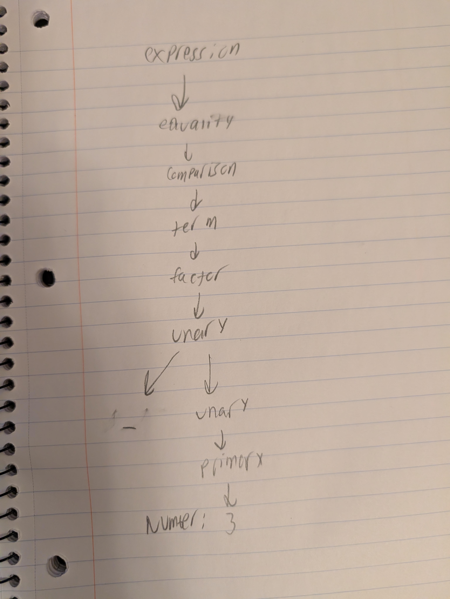

Lab 3 Report

I followed Lox and the slides pretty much exactly, using the same precedence and associativity rules

Grammar:

expression -> equality

equality -> comparison (("!=" | "==") comparison)*

comparison -> term ((">" | ">=" | "<" | "<=") term)*
term -> factor (("-" | "+") factor)*

factor -> unary (("/" | "*") unary)*

unary -> ("!" | "-") unary | primary

primary -> NUMBER | STRING | "true" | "false" | "nil"
        | "(" expression ")"

setup for tests: run test3.py in the lab3 folder under tests

Test cases:
(the actual output and expected output are all the same, since all unittests passed, also meaning that all results match expectations)

-test number:

    def test_number(self):
        output = "5.0"
        tokens = Scanner("5").scan()
        input = Parser(tokens).parse()

-test string:

    def test_string(self):
        output = "coolstring"
        tokens = Scanner('"coolstring"').scan()
        input = Parser(tokens).parse()

-test boolean and nil:

    def test_boolean_and_nil(self):
        for source, output in (("true", "True"), ("false", "False"), ("nil", "None")):
            with self.subTest(source=source):
                tokens = Scanner(source).scan()
                input = Parser(tokens).parse()

-test unary:

    def test_unary(self):
        output = "(- 5.0)"
        tokens = Scanner("-5").scan()
        input = Parser(tokens).parse()

-test nested unary:

    def test_nested_unary(self):
        output = "(! (! (- 5.0)))"
        tokens = Scanner("!!-5").scan()
        input = Parser(tokens).parse()

-test binary:

    def test_binary(self):
        output = "(+ 2.0 3.0)"
        tokens = Scanner("2 + 3").scan()
        input = Parser(tokens).parse()

-test group:

    def test_group(self):
        output = "(group 5.0)"
        tokens = Scanner("(5)").scan()
        input = Parser(tokens).parse()

-test precedence:

    def test_precedence(self):
        output = "(+ 2.0 (* 3.0 4.0))"
        tokens = Scanner("2 + 3 * 4").scan()
        input = Parser(tokens).parse()

-test group changes precedence:

    def test_group_changes_precedence(self):
        output = "(* (group (+ 2.0 3.0)) 4.0)"
        tokens = Scanner("(2 + 3) * 4").scan()
        input = Parser(tokens).parse()

-test comparison and equality:

    def test_comparison_and_equality(self):
        output = "(== (< 1.0 2.0) True)"
        tokens = Scanner("1 < 2 == true").scan()
        input = Parser(tokens).parse()

-test left associative:

    def test_left_associative(self):
        output = "(- (- 10.0 3.0) 2.0)"
        tokens = Scanner("10 - 3 - 2").scan()
        input = Parser(tokens).parse()

-test missing operand:

    def test_missing_operand(self):
        tokens = Scanner("1 +").scan()
        with self.assertRaises(SyntaxError):
            Parser(tokens).parse()

    Expected result: SyntaxError.
    Cause: The + operator requires a right operand, but the input ends.

My tree image: 

this represents -3 being the input, and the expected output would be (- 3.0), which matches what my program outputs. It follows my AST by creating a Unary node that contains the - token and the literal node.